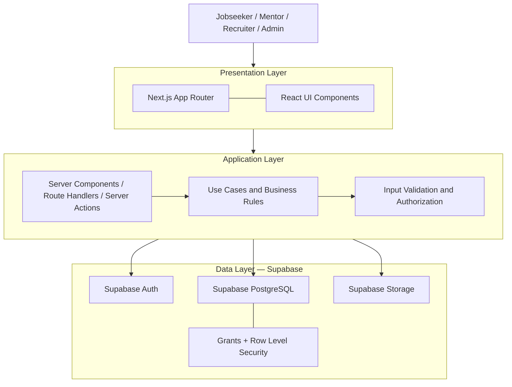

# Kestara — Supabase Architecture

> **Status:** Draft — requires Project Owner/PM and technical review  
> **Target:** Supabase PostgreSQL, Auth, Storage, and RLS  
> **Migration strategy:** Full migration from the existing MySQL/Prisma/NextAuth implementation  
> **Current Supabase project status:** Not created (last status supplied by Project Owner)

## 1. Purpose and Architecture Context

This document describes the target integration of Supabase into Kestara.

The project follows the Three-Tier Architecture described in the project context:

1. Presentation Layer
2. Application Layer
3. Data Layer

The team selected Supabase as the target backend platform. This is an implementation decision made by the team. Do not claim that the academic report explicitly names Supabase unless the report itself confirms it.

The repository snapshot previously audited used Next.js, React, TypeScript, Tailwind CSS, NextAuth, Prisma, and MySQL. The migration to Supabase has not yet been implemented. Re-check the current repository before changing dependencies or code.

## 2. Target Architecture



This is a logical diagram, not a rule that every database request must pass through a custom API. Direct browser-to-Supabase access may be used only for operations whose grants, RLS policies, and data exposure have been reviewed and tested. Sensitive business operations should be enforced on the server and/or database.

## 3. Layer Responsibilities

### 3.1 Presentation Layer

Technology:
- Next.js App Router
- React
- TypeScript
- Tailwind CSS

Responsibilities:
- Render pages, layouts, dashboards, and forms.
- Display role-appropriate navigation and actions.
- Handle UI states: loading, empty, success, and error.
- Perform client-side validation for usability.
- Never contain service-role credentials or other server secrets.

UI visibility is not authorization. Hiding a button does not prevent a user from calling an endpoint or database API directly.

### 3.2 Application Layer

Responsibilities:
- Implement use cases and business rules.
- Validate all untrusted input on the server boundary.
- Check authenticated identity and application role.
- Enforce company membership and resource ownership.
- Coordinate multi-step operations.
- Return safe errors and responses.
- Record privileged administrative actions where required.

Recommended implementation building blocks:
- Next.js Route Handlers for HTTP APIs.
- Server Actions where suitable for form mutations.
- Server-side service/use-case modules separate from UI components.
- Zod or another approved schema validator if already present or approved for the project.
- Supabase server client configured for SSR.

Do not introduce a new validation or service framework without checking the current dependency set and obtaining approval where required.

### 3.3 Data Layer

Supabase target services:

| Service | Responsibility |
|---|---|
| PostgreSQL | Relational application data, constraints, indexes, transactions |
| Auth | Authentication identities, sessions, email verification, password operations |
| RLS | Row-level authorization for exposed tables |
| Storage | User uploads and protected files |
| SQL migrations | Version-controlled database schema and policy changes |

## 4. Supabase Client Boundaries

Use separate client construction for browser and server contexts.

### Browser client

- Use only the Supabase URL and publishable/anon key intended for browser use.
- Never include a secret/service-role key in client bundles.
- Browser operations must be protected by database grants and RLS.
- Use the current recommended SSR/browser client pattern for the installed `@supabase/ssr` version.

### Server client

- Create a request-aware server client using the current Next.js cookie APIs and `@supabase/ssr`.
- Preserve the authenticated user's session when performing user-scoped database operations.
- Do not silently switch to a service-role client to bypass a failed RLS policy.
- Handle cookie reads/writes according to the installed Next.js version and Supabase SSR documentation.

### Elevated server client

A service-role or secret-key client bypasses normal RLS protections and is highly privileged.

- Keep it server-only.
- Never import it into client components or browser-reachable modules.
- Restrict use to narrowly scoped administrative or system operations.
- Perform explicit authorization before each elevated operation.
- Log sensitive administrative actions.
- Prefer narrowly scoped database functions or policies when they can safely implement the operation without broad service-role access.

## 5. Environment Variables

The exact variable names must be checked against the installed Supabase SDK version and deployment environment. A proposed `.env.example` shape is:

```dotenv
NEXT_PUBLIC_SUPABASE_URL=
NEXT_PUBLIC_SUPABASE_PUBLISHABLE_KEY=

# Server-only. Add only if an approved server operation requires it.
SUPABASE_SECRET_KEY=
```

Rules:
- `.env.local` and real environment files must not be committed.
- `.env.example` contains placeholders only.
- Never paste actual keys into Jira, Markdown docs, screenshots, commits, or AI prompts.
- Rotate any credential that may have been exposed.
- Do not retain the old MySQL `DATABASE_URL` in the final Supabase-only configuration unless a documented migration utility still needs it temporarily.
- Keep migration-only credentials outside application runtime configuration.

## 6. Authentication and User Provisioning

Application roles:
- `jobseeker`
- `mentor`
- `recruiter`
- `admin`

Public registration is available only for Jobseeker, Mentor, and Recruiter.

Admin provisioning must be controlled and must not be exposed as a public registration option.

The target identity relationship is:

```text
auth.users.id 1 ─── 1 public.users.id
```

`auth.users` owns authentication credentials. `public.users` owns application profile and authorization attributes.

Do not store passwords in `public.users`.

Role assignment must not trust a user-controlled request body or user-editable metadata. Choose and document one controlled provisioning approach before implementation, such as a server-validated registration flow or a carefully reviewed database trigger. The chosen approach must handle email verification, retries, partial failure, and duplicate profile creation.

## 7. Authorization Model

Use defense in depth:

1. Authentication establishes who the user is.
2. Application authorization determines whether the use case is permitted.
3. Database grants determine which operations a database role can attempt.
4. RLS determines which rows are visible or mutable.
5. Constraints protect data integrity regardless of UI behavior.

Core rules:
- A user may update only their own editable profile data.
- A user cannot change their own role or administrative account status.
- Skills and portfolio ownership must be tied to the authenticated user.
- Recruiter access to a company must be verified through an approved company membership/ownership model.
- Recruiter access to applications must be limited to authorized jobs/companies.
- Blind profile responses must be redacted before data reaches the recruiter client.
- Admin access is limited to the administrative function. Admin must not automatically receive unrestricted access to all portfolio, CV, or other sensitive content.
- Account deactivation must block the intended access paths; merely changing a UI status label is insufficient.

## 8. Storage Architecture

Use private buckets by default for user-controlled or sensitive files.

Candidate bucket plan (names are proposals, not created resources):

| Proposed bucket | Content | Default access |
|---|---|---|
| `profile-avatars` | Profile photos | Private until public visibility is explicitly approved |
| `portfolio-files` | Portfolio attachments | Private; owner-managed |
| `application-documents` | CV and application documents | Private; owner and specifically authorized recruitment flow |
| `company-assets` | Company logos and public assets | Public only if approved; otherwise private |
| `learning-materials` | Admin-managed learning files | Private or public according to publication/licensing rules |

Rules:
- Storage policies must be reviewed independently from table RLS.
- File path ownership should be validated against `auth.uid()`.
- Do not rely on client-provided MIME type or filename alone.
- Enforce allowed file types and size limits in the upload flow.
- Use short-lived signed URLs for private file access.
- Do not expose CVs or sensitive portfolio files through public buckets.
- Avoid putting personal data in object names or public metadata.
- Define retention and deletion behavior before implementing hard deletion.

## 9. SQL Migration Workflow

After the Supabase project is provisioned and the team approves the schema:

1. Install/use the Supabase CLI version agreed by the team.
2. Initialize the Supabase project structure.
3. Create migrations in `supabase/migrations/`.
4. Review each migration before applying it.
5. Test migrations against a local or disposable development database.
6. Include grants, RLS, functions, triggers, and indexes in version-controlled SQL.
7. Keep seed data synthetic and non-sensitive.
8. Apply reviewed migrations to the remote development project.
9. Verify schema and policies after deployment.
10. Never use untracked manual dashboard changes as the only record of database structure.

Suggested future repository structure:

```text
supabase/
├── config.toml
├── migrations/
├── seed.sql
└── tests/
```

Do not create placeholder migrations that pretend to be final schema. Migration files should represent reviewed, executable changes.

## 10. Full Migration Plan

The selected strategy is full migration. Execute it in controlled stages:

### Stage A — Inventory

- Find every Prisma client import and query.
- Find Prisma schema, migrations, seed scripts, and generated code.
- Find every NextAuth configuration, provider, callback, and session dependency.
- Find every MySQL-specific SQL statement and environment variable.
- Find password hashing/verification code such as bcryptjs.
- Map each existing feature to the approved target data model.

### Stage B — Target design

- Review proposal ERD.
- Approve target ERD and data dictionary.
- Approve role model and account lifecycle.
- Approve RLS matrix.
- Approve Storage classification and policies.
- Define migration and rollback strategy.

### Stage C — Supabase foundation

- Provision Supabase project.
- Configure environments.
- Set up CLI and local development.
- Implement schema migrations.
- Implement grants, RLS, helper functions, and triggers.
- Test Auth and profile provisioning.

### Stage D — Feature migration

- Migrate one approved PBI at a time.
- Replace data access with Supabase-compatible modules.
- Migrate authentication and session handling.
- Migrate file uploads.
- Preserve feature behavior and acceptance criteria.
- Update tests and documentation.

### Stage E — Verification and removal

- Run functional and regression tests.
- Run RLS tests for all roles.
- Test unauthenticated, cross-user, and cross-company access.
- Verify private file access.
- Verify data migration and record counts if existing data is migrated.
- Remove old Prisma/NextAuth/MySQL dependencies only after no references remain and the replacement passes tests.

## 11. Required Security Test Categories

- Unauthenticated user cannot access protected data.
- Jobseeker cannot modify another user's profile, skills, or portfolio.
- Mentor cannot modify another user's profile, skills, or portfolio.
- Recruiter cannot modify another user's profile, skills, or portfolio.
- Public registration cannot create an Admin.
- User cannot change own role or account status.
- Recruiter cannot access applications for an unrelated company/job.
- Blind screening response does not contain prohibited identity fields.
- Candidate cannot read correct assessment answers before or during an attempt.
- Private Storage objects cannot be fetched by unauthorized users.
- Deactivated accounts cannot continue protected actions.
- Admin actions are authorized and audited.

## 12. Open Decisions

The following decisions must be approved before production implementation:

- Exact Supabase project/environment strategy.
- Registration/profile provisioning mechanism.
- Role assignment and Admin provisioning procedure.
- Browser versus server access for each use case.
- Final database schema against proposal ERD.
- RLS helper function design and grants.
- Storage bucket names, visibility, file limits, and retention.
- Blind Profile field allowlist and identity reveal rules.
- Account deactivation behavior and hard-delete retention process.
- Data migration approach from MySQL.
- Backup, recovery, and deployment process.

## 13. Official References

- Supabase documentation: https://supabase.com/docs
- Supabase SSR with Next.js: https://supabase.com/docs/guides/auth/server-side/nextjs
- Database migrations: https://supabase.com/docs/guides/deployment/database-migrations
- Row Level Security: https://supabase.com/docs/guides/database/postgres/row-level-security
- Storage: https://supabase.com/docs/guides/storage
- Next.js documentation: https://nextjs.org/docs

Check current official documentation and the locally installed package versions before implementation.

---

**Status:** Draft. This document describes the selected target platform and proposed integration boundaries. It is not evidence that the Supabase project or migration has been completed.
