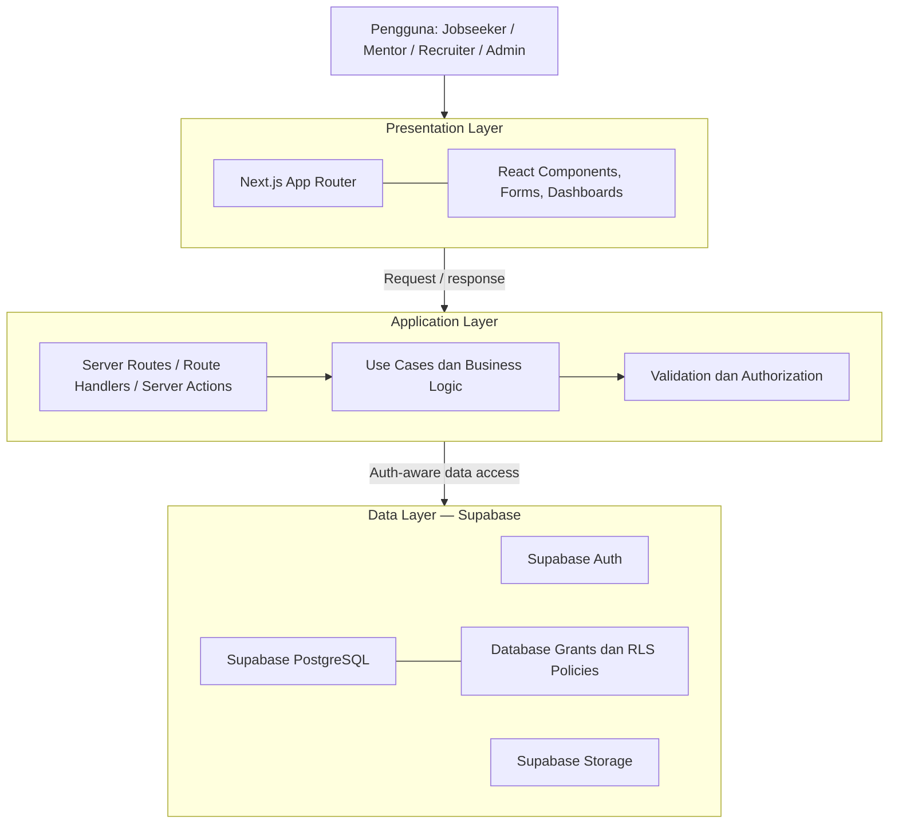
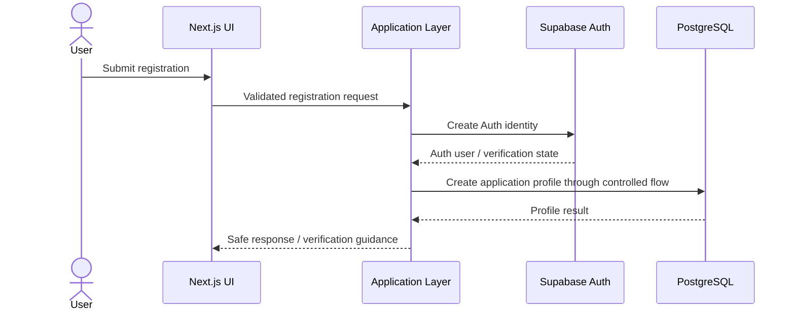

# Kestara — System Architecture

> **Document status:** Draft  
> **Architecture style:** Three-Tier Architecture  
> **Target backend platform:** Supabase  
> **Purpose:** Menjelaskan batas tanggung jawab Presentation, Application, dan Data Layer serta arah migrasi teknis.

## 1. Status dan Konteks

Laporan/proposal Kestara menetapkan Three-Tier Architecture dengan tiga lapisan:

1. Presentation Layer
2. Application Layer
3. Data Layer

Laporan membahas penggunaan database relasional (PostgreSQL atau MySQL). Tim kemudian memilih Supabase sebagai platform implementasi target dengan PostgreSQL, Auth, Storage, dan Row Level Security (RLS).

**Penting:** Three-Tier Architecture berasal dari arah arsitektur laporan. Supabase merupakan pilihan implementasi tim, bukan klaim bahwa laporan secara eksplisit menyebut Supabase.

Pada snapshot repository yang sebelumnya diperiksa, implementasi masih menggunakan MySQL, Prisma, dan NextAuth. Project Supabase belum dibuat dan migrasi belum selesai. Dokumen ini menjelaskan arsitektur target, bukan kondisi yang sudah berjalan.

## 2. Diagram Konseptual

Diagram ini menunjukkan pembagian tanggung jawab secara konseptual. Rincian endpoint, alur autentikasi, serta akses langsung dari browser ke Supabase harus ditetapkan pada dokumen frontend, API, dan security blueprint.

## 3. Presentation Layer

### Tanggung jawab

Presentation Layer menangani antarmuka dan interaksi pengguna, antara lain:

- Landing page dan halaman publik.
- Registrasi, login, dan alur verifikasi.
- Dashboard sesuai role.
- Form pengelolaan profil, skill, dan portofolio.
- Halaman lowongan, lamaran, pembelajaran, mentorship, dan komunitas.
- State UI: loading, empty, success, dan error.
- Responsivitas dan aksesibilitas.

### Teknologi target

- Next.js App Router
- React
- TypeScript
- Tailwind CSS

### Batasan

- Komponen UI tidak boleh menyimpan secret atau service-role key.
- Menyembunyikan elemen UI bukan mekanisme authorization.
- Input dari browser tidak boleh dianggap tepercaya.
- Validasi tampilan membantu UX, tetapi validasi dan otorisasi wajib dilakukan pada batas server/database.
- Gunakan design direction Green Teal dengan warna primer `#176B62`.

## 4. Application Layer

Application Layer mengelola use case, aturan bisnis, validasi, dan otorisasi.

### Tanggung jawab

- Mengorkestrasi proses registrasi dan pengelolaan profil.
- Memvalidasi input dan perubahan data.
- Memastikan pengguna hanya melakukan tindakan sesuai role dan kepemilikannya.
- Mengelola proses lowongan, lamaran, asesmen, mentorship, dan forum.
- Menyediakan endpoint server atau server actions sesuai kebutuhan.
- Menangani error dan mengembalikan response yang aman.
- Mencatat tindakan administratif yang perlu diaudit.

### Pola implementasi target

- Next.js Route Handlers untuk endpoint HTTP yang diperlukan.
- Server Actions untuk interaksi mutasi yang sesuai dengan pola aplikasi.
- Modul service/use-case untuk memisahkan business logic dari komponen UI.
- Validasi schema pada batas input server.
- Supabase server client yang dibuat dengan pola SSR yang sesuai versi package.

### Batasan

- Jangan menaruh business logic sensitif hanya di browser.
- Jangan percaya role yang dikirim melalui request body atau metadata yang dapat diubah pengguna.
- Jangan menggunakan service-role key sebagai cara pintas untuk melewati RLS.
- Operasi administratif yang membutuhkan privilege khusus harus berjalan di server, dengan pemeriksaan kewenangan yang eksplisit dan audit yang sesuai.

## 5. Data Layer

Supabase adalah platform data target yang dipilih tim.

### 5.1 PostgreSQL

PostgreSQL menjadi database relasional utama untuk data aplikasi, relasi antarentitas, constraint, dan transaksi.

### 5.2 Supabase Auth

Supabase Auth menjadi sistem autentikasi target. Identitas/kredensial dikelola oleh `auth.users`.

Tabel profil aplikasi seperti `public.users` direncanakan terhubung dengan `auth.users` menggunakan UUID. Password tidak disimpan dalam tabel profil aplikasi.

Role aplikasi yang disepakati:
- `jobseeker`
- `mentor`
- `recruiter`
- `admin`

Admin tidak tersedia pada registrasi publik dan harus dibuat melalui provisioning yang terkontrol.

### 5.3 Row Level Security

RLS digunakan untuk membatasi akses record di database berdasarkan identitas dan kewenangan.

Prinsip yang wajib dipenuhi:
- Aktifkan RLS pada tabel yang terekspos sesuai kebutuhan.
- Buat kebijakan terpisah untuk SELECT, INSERT, UPDATE, dan DELETE.
- Periksa ownership pada operasi data milik pengguna.
- Cegah pengguna mengubah `user_id`, role, atau status administratif yang bukan kewenangannya.
- Evaluasi database grants bersama RLS.
- Uji jalur allow dan deny untuk semua role.

RLS bukan pengganti validasi business logic; keduanya saling melengkapi.

### 5.4 Supabase Storage

Storage digunakan untuk file seperti foto profil, CV, portofolio, dan dokumen afirmasi jika fitur tersebut disetujui.

Dokumen sensitif harus berada pada private bucket. Kebijakan Storage harus diperiksa terpisah dari RLS tabel. Jangan menaruh file sensitif di bucket publik.

Nama bucket dan kebijakan final belum ditetapkan. Rinciannya harus ada di `docs/database/storage-policies.md`.

## 6. Alur Request Data yang Direkomendasikan

1. Pengguna berinteraksi melalui halaman Next.js.
2. Presentation Layer mengirim request ke jalur server atau operasi data yang memang diizinkan.
3. Application Layer memvalidasi input, session/identity, role, dan aturan bisnis.
4. Server melakukan akses data menggunakan Supabase client yang sesuai konteks autentikasi.
5. PostgreSQL menerapkan grants, constraints, dan RLS.
6. Untuk file, Supabase Storage menerapkan policy akses file.
7. Application Layer mengubah hasil menjadi response yang aman.
8. Presentation Layer menampilkan hasil tanpa membocorkan data sensitif.

Akses browser langsung ke Supabase hanya boleh digunakan untuk operasi yang memang aman dan sepenuhnya dibatasi oleh RLS serta policy yang benar. Keputusan endpoint-by-endpoint harus didokumentasikan; jangan menganggap semua operasi harus langsung dari browser atau semuanya harus melalui API server.

## 7. Autentikasi dan Role

### Target flow

Diagram ini adalah alur konseptual. Implementasi final harus menentukan penanganan email verification, trigger/profile provisioning, rollback/error handling, dan pencegahan akun Auth tanpa profil.

### Role assignment

- Role publik hanya `jobseeker`, `mentor`, atau `recruiter`.
- Role tidak boleh ditentukan dari input yang dapat dimanipulasi untuk memperoleh privilege.
- Admin dibuat melalui prosedur provisioning yang dikendalikan.
- Perubahan role dan status akun harus memiliki authorization dan audit trail yang sesuai.

## 8. Blind Profile dan Privasi

Blind Recruitment merupakan kebutuhan penting Kestara.

Prinsip arsitektur:
- Identitas kandidat harus disaring di server/database sebelum response dikirim kepada recruiter.
- Jangan mengirim PII lalu menyembunyikannya dengan CSS atau filter client-side.
- Buat jalur query/view/RPC khusus yang hanya mengembalikan atribut yang diizinkan untuk tahap screening.
- Validasi bahwa recruiter berhak melihat kandidat untuk lowongan/perusahaan terkait.
- Dokumen privat, nama file, URL, dan metadata tidak boleh membocorkan identitas secara tidak sengaja.
- Pembukaan identitas pada tahap wawancara harus mengikuti aturan seleksi yang disetujui.

Daftar field yang ditampilkan/disembunyikan dan kondisi pembukaan identitas harus difinalisasi dalam security dan product requirements. Jangan mengarang pengecualian.

## 9. Repository dan Source of Truth

Setelah migrasi Supabase dimulai, perubahan schema harus dikelola melalui SQL migrations yang disimpan di repository, misalnya dalam `supabase/migrations/`.

Prinsip:
- Migration file yang direview menjadi catatan perubahan schema.
- Jangan mengubah database remote secara manual tanpa mencatat perubahan sebagai migration.
- Seed data harus berupa data non-sensitif dan dapat diulang dengan aman.
- RLS dan Storage policies harus version-controlled.
- Uji migration dan policy sebelum diterapkan ke project remote.

Target migrasi penuh:
- MySQL → Supabase PostgreSQL.
- NextAuth → Supabase Auth.
- Prisma sebagai ORM utama → SQL migrations dan Supabase JS sebagai jalur data yang disepakati.

Jangan menghapus Prisma, NextAuth, atau konfigurasi lama sebelum seluruh pemakaian dipetakan, penggantinya selesai, dan pengujian berhasil.

## 10. Current State vs Target State

| Area | Kondisi terakhir yang diaudit | Target |
|---|---|---|
| Frontend | Next.js, React, TypeScript | Dipertahankan dan dikembangkan |
| Styling | Tailwind CSS | Green Teal design system |
| Database | MySQL | Supabase PostgreSQL |
| ORM/data access | Prisma | SQL migrations + Supabase JS |
| Authentication | NextAuth | Supabase Auth |
| File storage | Belum dikonfirmasi sebagai implementasi Supabase | Supabase Storage |
| Authorization | Perlu audit menyeluruh | Server authorization + RLS |
| Migration | Belum dilakukan | Full migration bertahap dan teruji |

## 11. Rencana Migrasi Arsitektur

1. Audit seluruh penggunaan Prisma, MySQL, NextAuth, dan bcryptjs.
2. Finalisasi ERD target dan mapping tipe data.
3. Buat project Supabase setelah desain disetujui.
4. Siapkan Supabase CLI dan migration workflow.
5. Implementasikan schema PostgreSQL, constraints, grants, dan RLS.
6. Siapkan Storage bucket dan policies.
7. Migrasikan autentikasi ke Supabase Auth.
8. Migrasikan data access dan business logic.
9. Jalankan pengujian fungsional, security, RLS, dan regression.
10. Hapus dependency serta kode lama hanya setelah tidak lagi digunakan dan penggantinya lolos verifikasi.

Setiap tahap perlu task Jira dan persetujuan sesuai kewenangan tim.

## 12. Keputusan yang Masih Terbuka

Sebelum dokumen ini menjadi Approved, tim perlu menetapkan:

- Detail alur registrasi, email verification, dan provisioning profil.
- Mekanisme provisioning Admin.
- Daftar tabel final berdasarkan ERD dan kebutuhan PBI.
- Matriks RLS per tabel dan per operasi.
- Daftar bucket, file size/type limits, dan Storage policies.
- Strategi akses browser vs server per use case.
- Mekanisme audit log dan retensi data.
- Strategi backup, environment, dan deployment.
- Desain aman untuk blind screening dan identity reveal.
- Strategi pengujian migration dan rollback.

## 13. Referensi Implementasi

Gunakan dokumentasi resmi yang sesuai versi dependency saat implementasi:

- Supabase Docs: https://supabase.com/docs
- Supabase SSR: https://supabase.com/docs/guides/auth/server-side/nextjs
- Supabase Database Migrations: https://supabase.com/docs/guides/deployment/database-migrations
- Supabase Row Level Security: https://supabase.com/docs/guides/database/postgres/row-level-security
- Supabase Storage: https://supabase.com/docs/guides/storage
- Next.js Docs: https://nextjs.org/docs

Periksa dokumentasi versi lokal Next.js di `node_modules/next/dist/docs/` sesuai instruksi `AGENTS.md` sebelum melakukan perubahan kode.

---

**Status dokumen:** Draft. Dokumen ini menjelaskan target arsitektur berdasarkan Three-Tier Architecture dan keputusan teknologi tim. Tinjau bersama PM/Project Owner dan cocokkan dengan laporan/proposal lengkap sebelum status diubah menjadi Approved.
