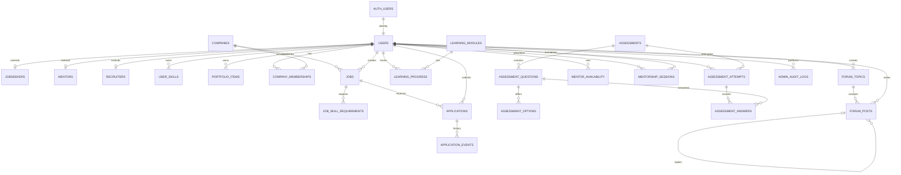
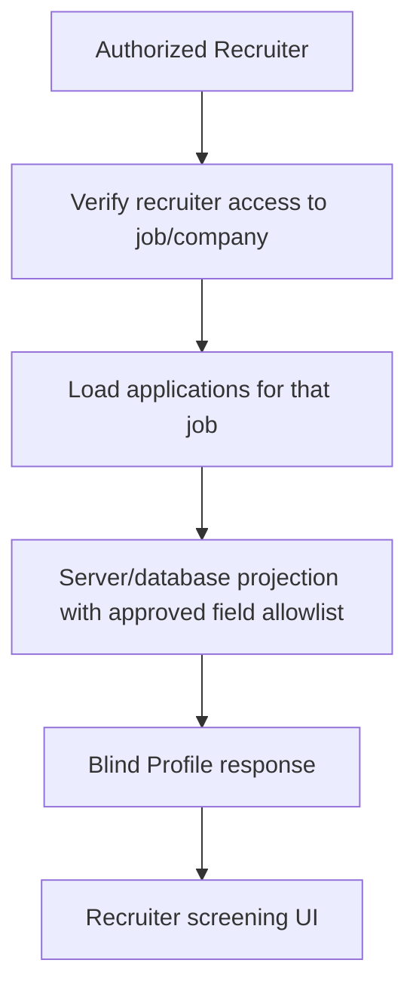

# Kestara — Database ERD (Conceptual Blueprint)

> **Status:** Draft — not an approved migration schema  
> **Target database:** Supabase PostgreSQL  
> **Important:** Validate this conceptual model against the original academic proposal/ERD before implementation. Table names and relationships marked as proposed are design recommendations, not confirmed existing tables.

## 1. Modeling Rules

- `auth.users` is managed by Supabase Auth.
- `public.users` is the application profile and role record, linked 1:1 to `auth.users`.
- Role-specific profile tables are optional extensions; their final fields must come from approved requirements.
- Skills and portfolio are shared tables for Jobseeker, Mentor, and Recruiter.
- Admin does not require a professional Skills Matrix or Portfolio.
- Every user-owned record must have an explicit owner relationship.
- Blind Profile must be a controlled projection of application data, not a client-side hiding trick.
- Use UUID identifiers and explicit foreign keys.
- Deactivation is the default account lifecycle action; permanent deletion requires a separately approved retention/purge process.

## 2. Conceptual ERD

The diagram shows proposed entities and relationships. It intentionally omits some attributes and constraints until the proposal and detailed PBI acceptance criteria are checked.

`AUTH_USERS` represents Supabase's managed `auth.users` relation; it is not a table the application should create or manage manually.

## 3. Proposed Entity Inventory

### Identity and profile

| Entity | Purpose | Status |
|---|---|---|
| `auth.users` | Supabase-managed authentication identity | Supabase managed |
| `public.users` | Application profile, role, account status | Proposed core table |
| `public.jobseekers` | Optional Jobseeker-specific profile extension | Proposed; fields TBD |
| `public.mentors` | Optional Mentor-specific profile extension | Proposed; fields TBD |
| `public.recruiters` | Optional Recruiter-specific profile extension | Proposed; fields TBD |
| `public.user_skills` | Shared skills matrix for all three public roles | Proposed |
| `public.portfolio_items` | Shared portfolio for all three public roles | Proposed |

### Company and vacancy

| Entity | Purpose | Status |
|---|---|---|
| `public.companies` | Company/partner information | Proposed |
| `public.company_memberships` | Maps recruiters to companies and their authorized relationship | Proposed; business rules TBD |
| `public.jobs` | Job vacancy data | Proposed |
| `public.job_skill_requirements` | Skills/competencies required by a vacancy | Proposed |
| `public.applications` | Candidate application to a vacancy | Proposed |
| `public.application_events` | Application status history/audit trail | Proposed |

### Micro-learning

| Entity | Purpose | Status |
|---|---|---|
| `public.learning_modules` | Micro-learning content and publication state | Proposed |
| `public.learning_progress` | Per-user learning progress | Proposed |

### Skill assessment

| Entity | Purpose | Status |
|---|---|---|
| `public.assessments` | Assessment definition/category | Proposed |
| `public.assessment_questions` | Question bank | Proposed |
| `public.assessment_options` | Answer options; correct-answer data must be protected | Proposed |
| `public.assessment_attempts` | User attempt and result | Proposed |
| `public.assessment_answers` | User responses | Proposed |
| `public.assessment_certificates` | Certificate/result artifact, if required by approved requirements | Optional proposal |

### Mentorship and community

| Entity | Purpose | Status |
|---|---|---|
| `public.mentor_availability` | Mentor availability slots | Proposed |
| `public.mentorship_sessions` | Mentorship requests and scheduled sessions | Proposed |
| `public.mentorship_messages` | Session-related messages, only if the approved requirement needs them | Optional proposal |
| `public.forum_topics` | Community discussion topics | Proposed |
| `public.forum_posts` | Posts and replies | Proposed |

### Administration

| Entity | Purpose | Status |
|---|---|---|
| `public.admin_audit_logs` | Record privileged administrative actions | Proposed |

## 4. PBI-01 Core Data Relationships

### `public.users`

One row per authenticated application user. Proposed columns:

- `id UUID` — primary key and FK to `auth.users.id`.
- `full_name TEXT`
- `role TEXT` — constrained to `jobseeker`, `mentor`, `recruiter`, `admin`.
- `account_status TEXT` — proposed values `active`, `suspended`, `deactivated`.
- `avatar_path TEXT` — Storage object path, not an unrestricted public URL.
- `phone_number TEXT` — optional.
- `bio TEXT` — optional.
- `created_at TIMESTAMPTZ`
- `updated_at TIMESTAMPTZ`

Do not duplicate authentication passwords. Email should normally remain in Supabase Auth unless a specific application requirement justifies a synchronized copy.

### `public.user_skills`

Proposed columns:

- `id UUID`
- `user_id UUID`
- `skill_name TEXT`
- `category TEXT`
- `proficiency_level TEXT`
- `description TEXT`
- `created_at TIMESTAMPTZ`
- `updated_at TIMESTAMPTZ`

A user may own many skills. Only Jobseeker, Mentor, and Recruiter may manage their own professional skills. The database must enforce this role rule, not merely the UI.

### `public.portfolio_items`

Proposed columns:

- `id UUID`
- `user_id UUID`
- `title TEXT`
- `description TEXT`
- `project_url TEXT`
- `media_path TEXT` — Storage path, if a file is uploaded.
- `start_date DATE`
- `end_date DATE`
- `created_at TIMESTAMPTZ`
- `updated_at TIMESTAMPTZ`

A user may own many portfolio items. Default file visibility should be private until a portfolio visibility policy is explicitly approved.

## 5. Relationship and Integrity Rules

1. `public.users.id` must correspond to exactly one `auth.users.id`.
2. A user must have exactly one application role.
3. Role-specific extension rows, if retained, must correspond to the matching role.
4. A user can own multiple skills and portfolio items.
5. A company can have multiple recruiter memberships, subject to an approved membership model.
6. A job belongs to a company and records its creator.
7. An application links one applicant to one job. Define a unique constraint for the intended duplicate-application rule after product approval.
8. Application status changes should be traceable if status history is required.
9. Learning progress belongs to one user and one learning module.
10. Assessment attempts belong to one user and one assessment.
11. Assessment answers belong to an attempt and a question.
12. Mentorship sessions must identify both the requesting Jobseeker and assigned Mentor.
13. Forum posts must identify their author and topic; replies may reference a parent post.
14. Audit records must identify the actor and action; do not cascade-delete audit history without an approved retention rule.

## 6. Blind Profile Data Flow

Recruiters must not receive a full candidate row and then hide identifying fields in the browser.

Proposed flow:

The field allowlist, matching score formula, and identity-reveal stage are not defined here. They require explicit product approval. Do not assume that name, email, phone, avatar, file metadata, or URLs are safe to expose.

## 7. Open Questions Before Final ERD

- Compare every entity against the original proposal ERD.
- Determine whether role-specific profile extension tables are required or whether a shared profile plus role-specific attributes is sufficient.
- Finalize company-to-recruiter ownership/membership rules.
- Finalize vacancy status values and close/delete semantics.
- Define application status lifecycle and cancellation rules.
- Define whether learning content has modules, lessons, attachments, or external links.
- Define assessment question types, answer-key protection, scoring, and certificate requirements.
- Define mentorship availability, booking conflicts, rescheduling, and messaging requirements.
- Define forum moderation and reply structure.
- Define retention, export, and hard-deletion rules.
- Define blind-profile fields and identity reveal authorization.

---

**Status:** Draft conceptual ERD. Do not generate production migrations from this document until it is compared with the original proposal and approved by the responsible team.
